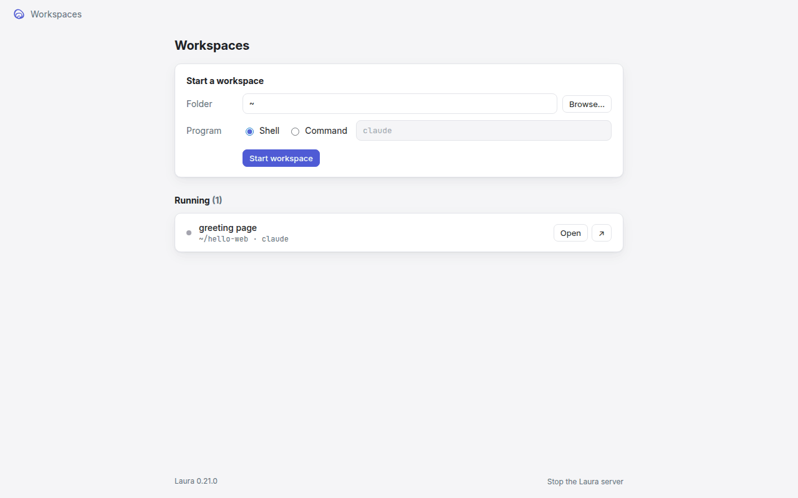

# Laura

Laura is a workspace that gives your agent an **API over the UI**, so your agent can tile panes while you pair-program.

<p align="center"></p>

Your agent can open the file you're discussing, the plan you're following, the diff you just made, or tail the logs of your running service. Laura works with every coding agent CLI, and your agent learns the `laura` CLI from Laura's agent skills.

> [!NOTE]
> Laura makes collaborating with your coding agent more enjoyable: riffing, reviewing live, solving problems and improvising together, without leaving the workspace.

> [!TIP]
> **New:** Laura started as a TUI workspace. Laura now opens in your browser, with rendered markdown, HTML pages and live web pages in browser panes. To keep working in the terminal, run `laura --tui`. See [Navigating the TUI](docs/tui-navigation.md).

**Laura lets you:**

- **Stay in the flow** - view a file, a plan, a diff, or a log right in the workspace, without switching windows between the terminal, IDE, and browser.
- **Compose the workspace** - your agent tiles the workspace as you chat, using the `laura` CLI and skills.
- **Pick your coding agent CLI** - Laura runs your agent in a plain shell, so Laura works with every agent CLI and model.
- **Interact in every pane** - comment on a file pane, a rendered markdown file or HTML page, or a browser pane, and submit the inline review into the chat.
- **Edit alongside your agent** *(experimental)* - edit a file in Neovim in an editor pane next to the chat, then flip to the file view to review your edits with your agent. [Enable editor panes](docs/cli.md#editor-panes).
- **See rendered pages** - Laura renders markdown files, and shows [HTML files as rendered pages](docs/navigation.md#html-files) with their scripts running.
- **See your web app** - show your dev server's page, or any web page, live in a browser pane, next to the chat. [Show a page in a browser pane](docs/workspace.md#show-a-web-app-in-a-browser-pane).
- **Learn while staying focused** - your agent shows and explains concepts live, step by step.

## How it works

Laura runs your agent CLI in a shell and provides agent skills that you or your agent can invoke. Your agent learns the `laura` CLI from the skills. The `laura` CLI sends messages to the workspace over an NDJSON protocol, with one socket per workspace. See the [protocol reference](docs/protocol.md) to learn more.

## Quickstart

**1. Install Laura.**

```bash
uv tool install laura-tui          # prebuilt for Linux, macOS and Windows
cargo install laura-tui --locked   # or build from source, with Rust (stable)
```

**2. Install the skills** so your agent knows how to use the `laura` CLI. In Claude Code:

```
/plugin marketplace add thomaseleff/laura-tui
/plugin install laura@laura-tui
```

**3. Start Laura** and run the interactive demo:

```bash
laura -- claude "/laura:demo"
```

Laura opens the workspace in your web browser. See [Start Laura](docs/workspace.md#start-laura).

**4. Pair-program.** Chat as you normally would with your coding agent. Ask your agent to show you a file, a plan, or a diff using the `/laura` skill.

Laura reloads a file pane when its file changes. Laura shows [markdown as rendered markdown](docs/navigation.md#markdown-files) and other files with syntax colours. Laura marks the lines changed since git `HEAD` in the gutter.

See the [tutorial](docs/tutorial.md) for a first session, [Navigating the workspace](docs/navigation.md) for the keystrokes and clicks, and [Navigating the TUI](docs/tui-navigation.md) for what is different in the terminal. For reference, see the [CLI reference](docs/cli.md) for every command and flag, the [protocol reference](docs/protocol.md) for the message format, and the [agent reference](docs/agent-reference.md) for how your agent uses the `laura` CLI.

## License

MIT — see [LICENSE](LICENSE).

The web app bundles the Inter and JetBrains Mono fonts under the SIL Open Font License — see [OFL.txt](assets/web/fonts/OFL.txt).
